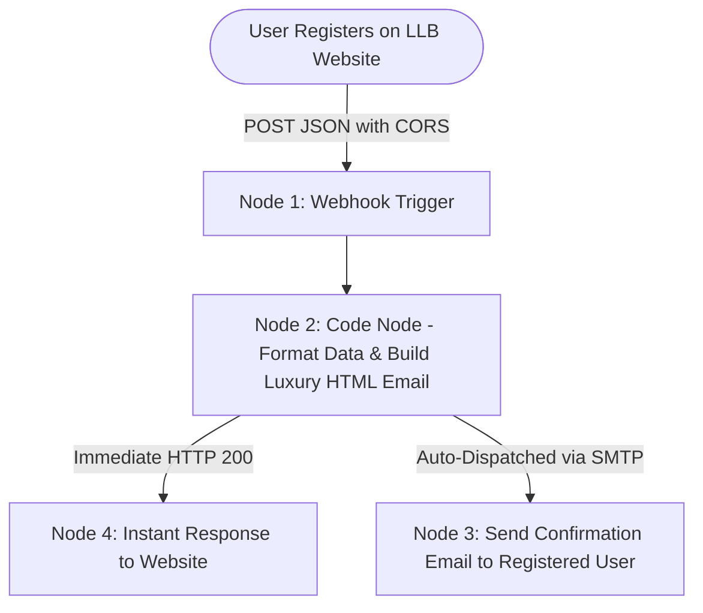

# ⚙️ n8n Lead Automation Workflow — Complete Technical & Execution Guide
### For LLB Real Estate VIP Registration & Instant Automated Email Pipeline

This guide provides end-to-end instructions for importing, configuring SMTP credentials, and running the **n8n automation workflow** that powers the LLB Real Estate website.

---

## 🏛️ Workflow Architecture

---

## 📁 Workflow File
The full workflow JSON is ready for 1-click import:
**[`llb_n8n_automation_workflow.json`](file:///c:/Users/chand/Downloads/ai-agent-1/ai-agent-1/llb-real-estate/llb_n8n_automation_workflow.json)**

---

## 🚀 3-Minute Setup: What You Need To Do

### Step 1: Import Workflow into n8n
1. Open your n8n workspace:
   - **n8n Cloud:** `https://app.n8n.cloud`
   - **Local n8n:** `http://localhost:5678`
2. In the left sidebar, click **Workflows**.
3. In the upper-right corner, click **Add Workflow** or the **Three Dots (...)** menu &rarr; **Import from File**.
4. Select `llb_n8n_automation_workflow.json`.
5. You will see the complete 4-node pipeline with visual **Sticky Note Guides** right on your canvas.

---

### Step 2: Configure Your SMTP Email & Password

1. Double-click the node named **`3. Send Confirmation Email to Registered Client`**.
2. Under **Credential for SMTP**, click the dropdown and choose **Create New Credential** (or select your existing SMTP account).
3. Fill in your email account details:

#### 🔹 For Gmail (Most Popular):
| Field | Value |
|---|---|
| **User** | Your full Gmail address (e.g. `yourname@gmail.com`) |
| **Password** | Your **Google App Password** *(16-character code, see below)* |
| **Host** | `smtp.gmail.com` |
| **Port** | `465` |
| **SSL/TLS** | **ON** (Enabled) |

> [!TIP]
> **How to get a Gmail App Password in 60 seconds:**
> 1. Go to your Google Account: [https://myaccount.google.com/security](https://myaccount.google.com/security)
> 2. Ensure **2-Step Verification** is turned ON.
> 3. Search for **"App passwords"** in the top search bar (or go to [https://myaccount.google.com/apppasswords](https://myaccount.google.com/apppasswords)).
> 4. Enter a name (e.g., `LLB Real Estate n8n`) and click **Create**.
> 5. Copy the 16-character password and paste it into n8n's **Password** field.

#### 🔹 For Microsoft Outlook / Office 365:
| Field | Value |
|---|---|
| **User** | Your full Outlook/Office 365 email (e.g. `you@outlook.com`) |
| **Password** | Your Outlook account or App password |
| **Host** | `smtp.office365.com` |
| **Port** | `587` |
| **SSL/TLS** | **OFF** (uses STARTTLS) |

#### 🔹 For Custom Business Domain / cPanel SMTP:
| Field | Value |
|---|---|
| **User** | Your webmail/domain address (e.g. `inquiries@yourdomain.com`) |
| **Password** | Your email password |
| **Host** | `mail.yourdomain.com` |
| **Port** | `465` (SSL) or `587` (TLS) |

4. **CRITICAL STEP — Update "From Email":**
   Inside the node parameter **From Email**, change it to **your authenticated email address** (e.g., `yourname@gmail.com` or `LLB Real Estate <yourname@gmail.com>`).
   *(This ensures Gmail/Outlook does not reject the email for sender mismatch).*
5. Click **Save** in n8n.

---

### Step 3: Copy Webhook URL & Link to Website

1. Double-click **`1. Inbound Registration Webhook`**.
2. Copy the **Production URL**:
   - Format: `https://your-n8n.cloud/webhook/llb-property-inquiry`
   - *(Or Test URL: `https://your-n8n.cloud/webhook-test/llb-property-inquiry` if debugging with "Listen for test event")*.
3. Open your LLB Real Estate website: [http://localhost:8080/index.html](http://localhost:8080/index.html).
4. Click the **"n8n Setup"** button in the top navigation bar.
5. Paste your Webhook URL into the input field and click **"Save Webhook URL"**.
6. In n8n, toggle the switch at the top right from **Inactive** to **ACTIVE**!

---

## 🧪 Testing the Live Execution

1. On the LLB Real Estate website, click **"Send Live Test Lead"** in the n8n Setup modal, OR:
2. Fill out the **VIP Client Registration** form on the homepage:
   - Full Name: `Jane Doe`
   - Email: *(your real test email)*
   - Phone: `+1 (555) 234-5678`
   - Property: `The Grand Horizon Sky Penthouse`
   - Budget: `$3,000,000 - $5,000,000`
   - Click **"Submit VIP Registration & Send Confirmation Email"**.
3. **Check the result:**
   - The website immediately displays the animated **VIP Registration Confirmed** modal with a reference ID (e.g. `LLB-8B41D9`).
   - Check your inbox: the registered user receives the bespoke **80% White / 20% Black luxury HTML confirmation email** with full property specifications, reference ID, legal deed vetting guarantee, and VIP concierge contacts!
   - In n8n, check **Executions** tab: you will see a green **Success** status with all execution data.

---

## 🛠️ Troubleshooting FAQ

### 1. `535 5.7.8 Authentication failed`
- **Cause:** Using standard Gmail password instead of an App Password, or typo in username.
- **Fix:** Enable 2FA on Google Account and generate a 16-letter **App Password**; paste it into n8n without spaces.

### 2. `553 5.7.1 Sender address rejected / not owned by user`
- **Cause:** The `From Email` field in the Send Email node differs from your authenticated SMTP user.
- **Fix:** Make sure the `From Email` in the Send Email node matches your SMTP user email.

### 3. `Failed to fetch / CORS error`
- **Cause:** The n8n Webhook node headers missing CORS permission.
- **Fix:** The provided `llb_n8n_automation_workflow.json` already has `Access-Control-Allow-Origin: *` configured in the Webhook node options.

---

## 💻 Built-in Local Engine (Offline / Local Dev Fallback)

If n8n is offline or you want to test without an external service, the local server handles everything:
- **Server:** `python serve.py` (running on `http://localhost:8080`)
- **Admin Hub:** `http://localhost:8080/admin.html`
- **Local Webhook:** `http://localhost:8080/webhook/llb-property-inquiry`
- **Sent Email Previews:** Automatically rendered in `sent_emails/<leadId>.html`
