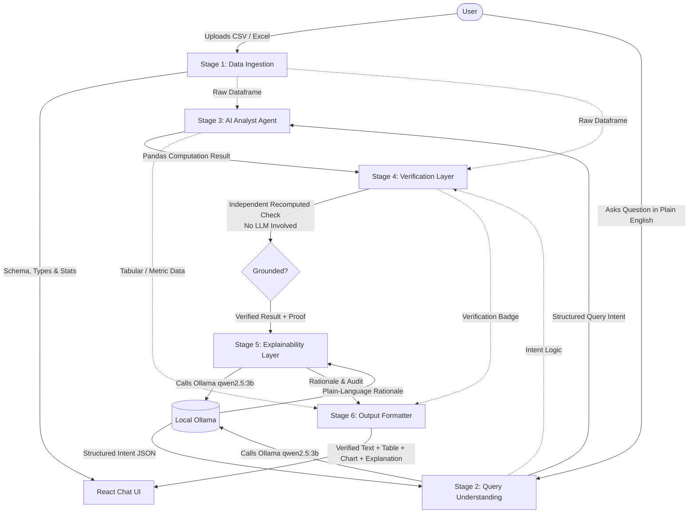

# VeriAnalyst — Explainable AI Agent for Conversational Data Analysis

> **VeriAnalyst** is an explainable, grounded AI agent for conversational tabular data analysis. Users can upload a CSV or Excel file, ask questions in plain English, and receive verified, mathematically grounded answers with transparent step-by-step rationales—preventing black-box LLM hallucinations.

---

## 🏛️ System Architecture



---

## 🔄 The 6 Pipeline Stages Explained

### 1. Data Ingestion (`stage1_ingestion.py`)
- **Purpose**: Ingest tabular data from `.csv` and `.xlsx` files.
- **Actions**:
  - Automatically infers data types, detects null/missing values, and computes summary statistics.
  - Profiles column distributions and extracts sample rows for UI preview and LLM context.
  - Caches the dataset for high-performance retrieval across user questions.

### 2. Query Understanding (`stage2_query_understanding.py`)
- **Purpose**: Parse user questions into structured analytical intentions.
- **Actions**:
  - Leverages local Ollama with `qwen2.5:3b` via `llm_client.py`.
  - Prompts the LLM with the dataset column profile and the user's natural language question.
  - Generates strict, validated JSON containing:
    - `operation`: (`sum`, `mean`, `max`, `min`, `count`, `filter`, `groupby_agg`, etc.)
    - `target_column`: The primary metric or column to aggregate.
    - `group_by_column`: Optional dimension for categorical groupings.
    - `filter_conditions`: List of row-level filters (column, operator, value).

### 3. AI Analyst Agent (`stage3_analyst_agent.py`)
- **Purpose**: Execute the intended data operations on the real, in-memory dataset.
- **Actions**:
  - Translates the structured intent from Stage 2 into idiomatic, safe `pandas` operations.
  - Executes filtering, groupings, and aggregations directly on the in-memory DataFrame.
  - Captures execution time, output data types (scalar, Series, or DataFrame), and raw output.

### 4. Verification Layer (`stage4_verification.py`)
- **Purpose**: Ensure mathematical correctness and eliminate LLM hallucinations.
- **Actions**:
  - **No LLM involved**: Operates purely on deterministic algorithms.
  - Independently recomputes the calculation using an alternate calculation path or sanity audit directly from the structured intent and raw data.
  - Compares the recomputed value against the Analyst Agent's result.
  - Flags any discrepancies or certifies the result as `exact_match` or `tolerance_match`.

### 5. Explainability Layer (`stage5_explainability.py`)
- **Purpose**: Provide human-friendly transparency for how the conclusion was reached.
- **Actions**:
  - Employs local `qwen2.5:3b` to articulate the computation in plain English.
  - Summarizes the exact filters applied (e.g., "Excluding rows where Status is Inactive"), the aggregation method, and any edge-case data caveats.
  - Translates technical code operations into an accessible, step-by-step narrative.

### 6. Output Formatter (`stage6_output_formatter.py`)
- **Purpose**: Package the results into a multi-modal response for the frontend.
- **Actions**:
  - Formulates concise, natural language answer text.
  - Prepares tabular preview data for structured query responses.
  - Generates chart specifications (`bar`, `line`, `pie`, `scatter`) when results warrant visualization.
  - Attaches the verification status badge and the expandable explanation payload.

---

## 📁 Project Directory Structure

```
ai-agent-1/
├── README.md                      # Project architecture & pipeline guide
├── .gitignore                     # Environment & runtime ignores
├── data/
│   ├── samples/                   # Sample datasets for development
│   └── uploads/                   # Uploaded CSV/Excel files storage
├── backend/
│   ├── requirements.txt           # Python dependencies (FastAPI, pandas, openpyxl, httpx)
│   ├── main.py                    # FastAPI application entrypoint & CORS setup
│   ├── tests/
│   │   ├── __init__.py
│   │   └── test_pipeline_stubs.py # Pipeline stub verification tests
│   └── app/
│       ├── __init__.py
│       ├── api/
│       │   ├── __init__.py
│       │   └── routes.py          # /upload, /query, and /health endpoints
│       ├── core/
│       │   ├── __init__.py
│       │   ├── config.py          # App settings & paths
│       │   └── llm_client.py      # Local Ollama client (qwen2.5:3b at :11434)
│       ├── models/
│       │   ├── __init__.py
│       │   └── schemas.py         # Pydantic models & contracts for all 6 stages
│       └── pipeline/
│           ├── __init__.py
│           ├── stage1_ingestion.py           # Stage 1: Data Ingestion
│           ├── stage2_query_understanding.py # Stage 2: Query Understanding
│           ├── stage3_analyst_agent.py       # Stage 3: AI Analyst Agent
│           ├── stage4_verification.py        # Stage 4: Verification Layer
│           ├── stage5_explainability.py      # Stage 5: Explainability Layer
│           └── stage6_output_formatter.py    # Stage 6: Output Formatter
└── frontend/
    ├── package.json               # React dependencies & scripts
    ├── public/
    │   └── index.html             # Application HTML template
    └── src/
        ├── index.js               # React mounting entrypoint
        ├── App.jsx                # Main workspace component
        ├── App.css                # VeriAnalyst design system & theme
        ├── services/
        │   └── api.js             # Client service for backend REST endpoints
        └── components/
            ├── FileUpload.jsx         # Upload dropzone for CSV/Excel
            ├── DatasetPreview.jsx     # Schema, column profiles, missing stats
            ├── ChatInterface.jsx      # Conversational query thread & input
            ├── AnswerCard.jsx         # Verified answer card with badge
            ├── ExplanationPanel.jsx   # Expandable explanation & grounding audit
            └── ChartRenderer.jsx      # Interactive visualization renderer
```

---

## 🤖 Local LLM Setup

- **Provider**: [Ollama](http://localhost:11434)
- **Model**: `qwen2.5:3b`
- **Configuration**: Managed centrally in `backend/app/core/llm_client.py` using `backend/app/core/config.py`.
- **Health Check**: `GET /api/health` queries Ollama's `/api/tags` to ensure the model is loaded and ready before queries are processed.

---

## 🚀 Running the Scaffolding

### Backend Setup
1. Create and activate a Python virtual environment:
   ```bash
   python -m venv venv
   # On Windows:
   .\venv\Scripts\activate
   ```
2. Install dependencies:
   ```bash
   pip install -r backend/requirements.txt
   ```
3. Run the backend development server:
   ```bash
   uvicorn backend.main:app --reload --port 8000
   ```
   Interactive API docs will be available at: `http://localhost:8000/docs`.

### Frontend Setup
1. Navigate into the frontend folder:
   ```bash
   cd frontend
   ```
2. Install dependencies:
   ```bash
   npm install
   ```
3. Start the React development server:
   ```bash
   npm start
   ```
   The UI will launch at: `http://localhost:3000`.

---

## 🛠️ Next Steps

The scaffolding is prepared with clean contracts, Pydantic schemas, and stub modules for all 6 pipeline stages. Stages can now be implemented incrementally:
1. **Stage 1 Implementation**: File ingestion, column profiling, and type detection.
2. **Stage 2 Implementation**: Prompt engineering `qwen2.5:3b` for query intent extraction.
3. **Stage 3 Implementation**: Pandas execution engine for analytical operations.
4. **Stage 4 Implementation**: Independent deterministic verification layer.
5. **Stage 5 Implementation**: Rationale and explainability generation.
6. **Stage 6 Implementation**: Chart generation and output formatting.
