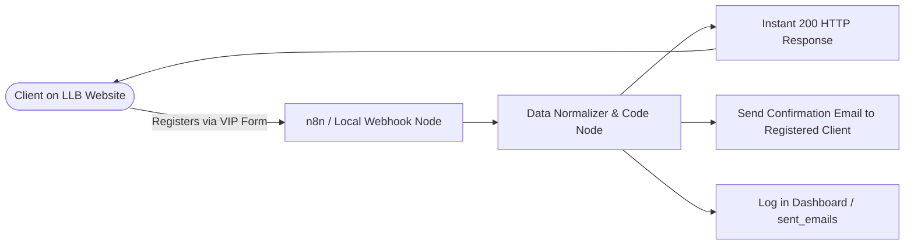

# 🏛️ LLB Real Estate — Premium Agency Website with n8n Email Automation

> **Prime Properties. Legally Verified. Unrivaled Luxury.**  
> A high-conversion luxury real estate website integrated with an **n8n automation backend** and **local automation engine** for instantaneous lead registration, automatic verification, and personalized VIP confirmation emails.

---

## 🌟 Architecture & Data Flow



---

## 📁 File Structure

```
llb-real-estate/
├── index.html                           # Main luxury website with property catalog & registration
├── admin.html                           # Real-time lead verification & email delivery dashboard
├── styles.css                           # High-end responsive CSS stylesheet (80/20 luxury theme)
├── app.js                               # Application logic, filters & EMI calculator
├── config.js                            # Company details & default webhook settings
├── properties-data.js                   # Curated luxury property listings dataset
├── n8n-integration.js                   # Webhook engine, diagnostics & fallbacks
├── llb_n8n_automation_workflow.json    # Ready-to-import email-only n8n workflow template
├── N8N_WORKFLOW_GUIDE.md                # Comprehensive n8n setup manual
├── serve.py                             # Local automation server & SMTP email dispatcher
├── run_website.bat                      # 1-Click launcher script for Windows
├── data/                                # Lead database (leads.json) & SMTP config
└── sent_emails/                         # Rendered HTML confirmation emails preview directory
```

---

## 🚀 How to Run the Website Locally

### Option A: Using Python (Recommended)
From this directory, run:
```bash
python serve.py
```
This automatically starts the server at `http://localhost:8080/index.html` and opens the **Admin Dashboard** at `http://localhost:8080/admin.html`.

### Option B: Using 1-Click Windows Batch Script
Double-click `run_website.bat`.

---

## ⚙️ Connecting n8n for Confirmation Emails

1. **Import Workflow:** Open n8n, click **Workflows &rarr; Import from File**, and choose `llb_n8n_automation_workflow.json`.
2. **Connect Email Credentials:** In Node 3 (*Send Confirmation Email to Registered Client*), connect your Gmail account or SMTP credentials.
3. **Copy Webhook URL:** Copy the Webhook URL from Node 1 and paste it into the **n8n Setup** modal on the website (or into `config.js`).
4. **Publish/Activate:** Toggle the workflow to **Active**. Every registered email address will automatically receive a confirmation mail!
